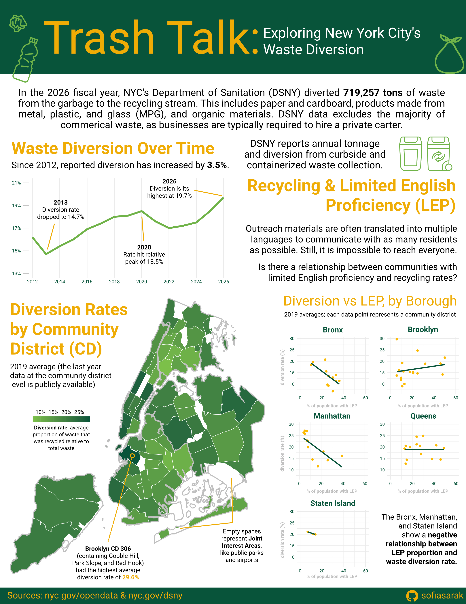

# Trash Talk: Exploring New York City's Waste Diversion

I recently started a job supporting NYC's Department of Sanitation (DSNY)! To celebrate, I created an infographic exploring some of the city's publicly-available sanitation data. Primarily, I explored patterns in NYC's **waste diversion** (the proportion of waste that gets recycled relative to total waste) across space and time. 

## Repository Structure
```
├── plots # contains the final three viz I brought into Affinity
│   ├── map.pdf
│   ├── scatter.pdf
│   └── yearly.pdf
└── viz.qmd # quarto doc with all code for data cleaning and viz
└── dsny_infographic.jpg # final infographic image
```
## Data Sources
- [NYC Open Data](https://www.nyc.gov/opendata): Waste diversion and limited English proficiency rates at the community district level
- [DSNY](https://www.nyc.gov/site/dsny/resources/statistics/total-annual-collection-diversion.page): Yearly diversion (in separate PDF docs - had to compile manually).

## Tools
For the most part, I used R's {ggplot2} and {sf} packages to create the three data visualizations. Affinity was used to compile them into one infographic. DSNY's website and branding inspired the color palette.

## Final Infographic
<p align="center">
  
</p>
